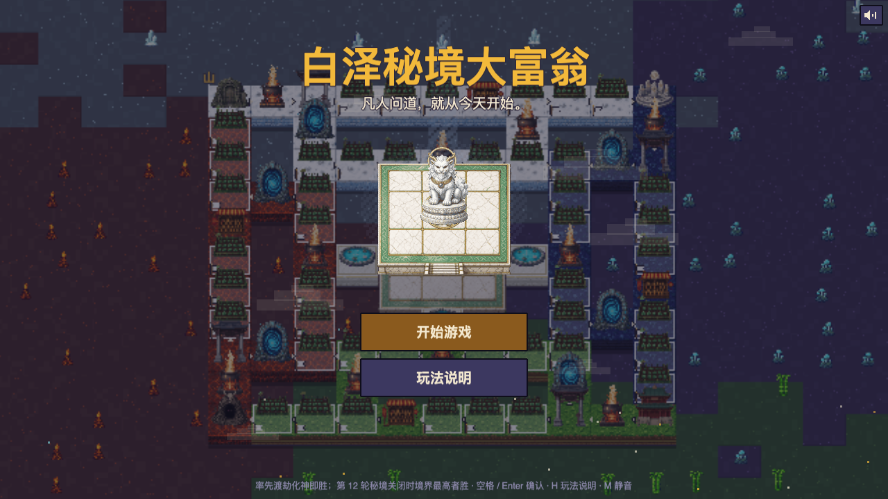
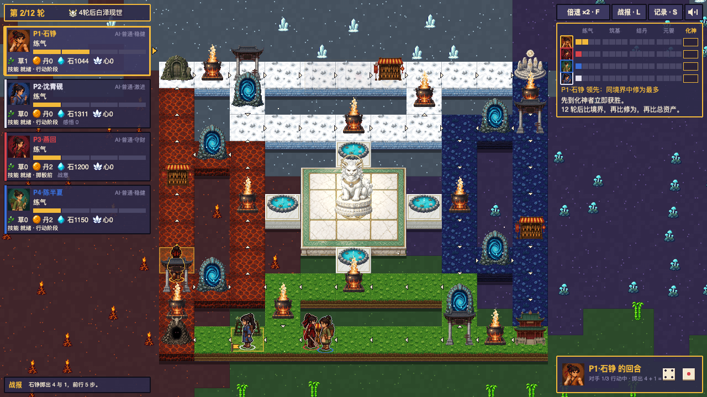

# Baize Realm Monopoly (白泽秘境大富翁)

[中文](README.md) · [Play online](https://rich.fxai.ai)

A pixel-art, Eastern-fantasy cultivation board game in the Monopoly tradition. It runs in the browser. One to four local players, with AI filling empty seats. A game takes 20 to 30 minutes. The game text and design documents are in Chinese.



## How it plays

Four ordinary teenagers enter the Baize Realm. The Monopoly skeleton only exists to accumulate resources. The real spine of the game is one thing, cultivation realm:

```
spirit fields (rent, herbs) → alchemy rooms (herbs become pills) → breakthrough retreat (stake pills for odds) → realm → first to Spirit Transformation wins
```

- Every breakthrough is a dice check, and failure causes qi deviation. When to gamble and how many pills to stake is the biggest decision of the game.
- Carrying many pills makes you glow, and rivals you meet on the road can duel you for them.
- The realm closes after twelve rounds. If nobody has ascended, players are ranked by realm, cultivation, then total assets.



The full rules are in [`docs/GDD.md`](docs/GDD.md) (Chinese).

## Run it

Requires Node.js 22.12 or later (the Dockerfile uses Node 24).

```bash
cd game
npm install
npm run dev        # open http://localhost:5173
```

URL parameters. `?auto=1` starts a game of four AIs, `?seed=123` fixes the random seed, and `?speed=1` sets the animation speed.

```bash
npm test                                # unit tests
npm run build                           # type check + production build
npm run sim -- --games 500 --seed 1     # headless AI self-play with balance statistics
```

More commands (parameter sweeps, game replay, board validation) are in [`game/README.md`](game/README.md) (Chinese).

## Repository layout

```
docs/     design document (GDD, the single source of rules), copy, asset list, dev summary, board design, history
data/     all numbers and content (board, heroes, spells, events, config); the game only reads them
assets/   Phaser atlas (103 frames) and single sprites
tools/    art generation scripts (not part of the game build)
game/     the playable prototype: Phaser 3 + TypeScript + Vite + vitest
deploy/   maintainer notes on image publishing and deployment (full workflow in [`docs/maintainers.md`](docs/maintainers.md), Chinese only)
```

The rules engine (`game/src/core/`) is plain TypeScript and never imports Phaser. One engine drives the UI, the AI and headless simulation. All randomness goes through a reproducible RNG, so any game can be replayed from its setup plus the list of answers.

## Art and assets

The art in this repository is generated with gpt-image and then pixelized. It is prototype-quality and meant to be redrawn by artists for a release (see [`docs/assets.md`](docs/assets.md)). No font is bundled, so the game uses system fonts. Music and sound effects are synthesized in real time with WebAudio, so there are no audio files.

## Contributing and license

See [CONTRIBUTING.en.md](CONTRIBUTING.en.md). Released under the [MIT License](LICENSE), copyright © 2026 白泽明理 (fxai.ai). Code, documents, data and the prototype art all use this license.
