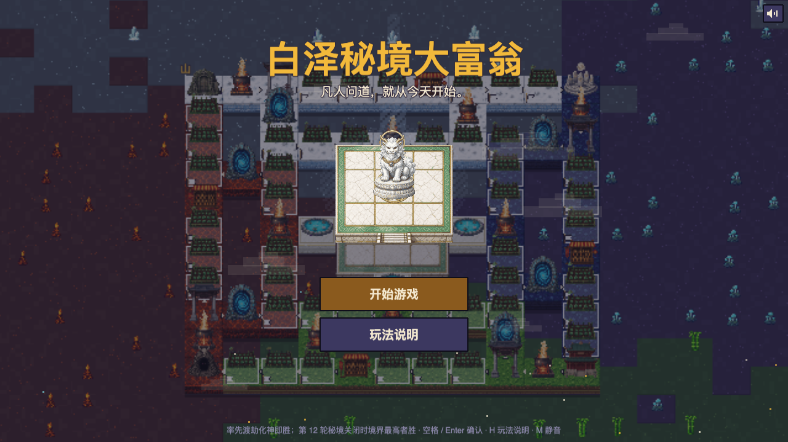
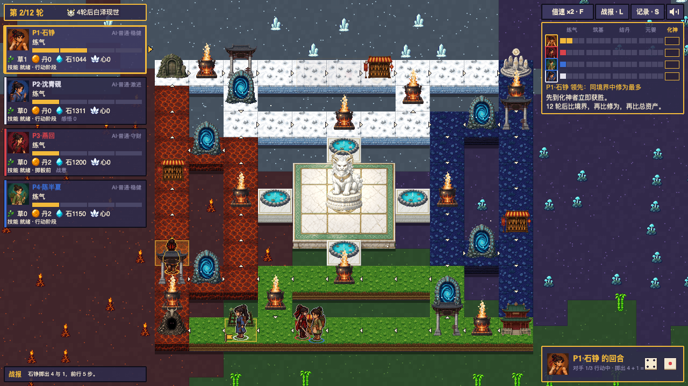

# 白泽秘境大富翁

[English](README.en.md) · [在线试玩](https://rich.fxai.ai)

像素风、凡人流修仙的大富翁式桌游，浏览器里玩。1 到 4 名本地玩家，空位由 AI 补齐，一局 20 到 30 分钟。



## 怎么玩

四个资质平平的少年闯进白泽秘境。大富翁的骨架只负责攒资源，真正的主线只有一条，境界：

```
灵田（收租、产灵草） → 丹房（灵草炼成丹药） → 闭关突破（押丹药换成功率） → 境界 → 先化神者胜
```

- 每次突破都要掷骰检定，失败会走火入魔。什么时候赌、押多少丹药，是整局最重要的决定。
- 丹药揣多了会冒宝光，路上遇见的同道可以斗法夺宝。
- 秘境只开十二轮。到时没人化神，就按境界、修为、总资产排名。



完整规则见 [`docs/GDD.md`](docs/GDD.md)。

## 运行

需要 Node.js（Dockerfile 使用 Node 24）。

```bash
cd game
npm install
npm run dev        # 浏览器打开 http://localhost:5173
```

常用参数：`?auto=1` 直接开一局 4 个 AI 对战，`?seed=123` 固定随机种子，`?speed=1` 调整动画倍速。

```bash
npm test                                # 单元测试
npm run build                           # 类型检查 + 生产构建
npm run sim -- --games 500 --seed 1     # AI 无头自对弈，输出平衡统计
```

更多命令（参数扫描、对局重放、地图校验等）见 [`game/README.md`](game/README.md)。

## 项目结构

```
docs/     GDD（规则的唯一来源）、文案、资产清单、开发总结、棋盘设计、历史记录
data/     全部数值与内容（棋盘、修士、符箓、机缘、config），游戏只读取不修改
assets/   Phaser 图集（103 帧）与单帧精灵
tools/    美术出图脚本（不参与游戏构建）
game/     可运行原型：Phaser 3 + TypeScript + Vite + vitest
deploy/   维护者自用的镜像发布与部署说明（总流程见 [`docs/maintainers.md`](docs/maintainers.md)）
```

规则引擎（`game/src/core/`）是纯 TypeScript，不依赖 Phaser。同一个引擎同时驱动画面、AI 和无头模拟，所有随机都走可复现的随机数，所以一局可以按「初始设置 + 回答历史」完整重放。

## 美术与素材

仓库里的美术是 gpt-image 生成后再像素化的样稿，用于原型开发，正式版需要画师重绘（来源与流程见 [`docs/assets.md`](docs/assets.md)）。游戏没有内置字体，默认使用系统字体，正式版计划使用缝合像素（Fusion Pixel，OFL）。音效和背景乐由 WebAudio 实时合成，没有音频文件。

## 许可证

[MIT](LICENSE)，版权所有 © 2026 白泽明理（fxai.ai）。仓库内的代码、文档、数据和美术样稿都按此许可证发布。
